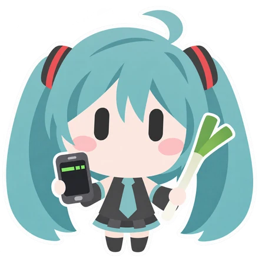
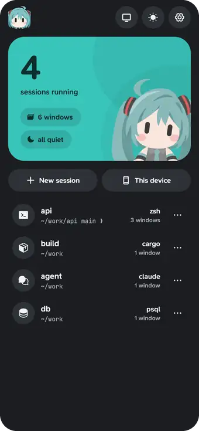
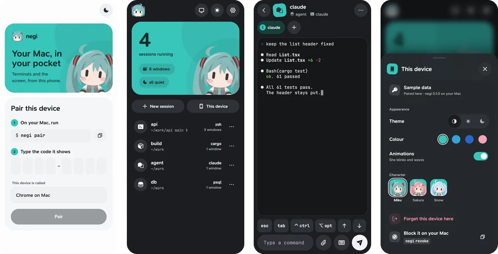

<p align="center">
  
</p>

<h1 align="center">negi</h1>

<p align="center">tmux and your Mac's screen, on your phone.</p>

<p align="center">
  <a href="https://github.com/rifuki/negi/releases/latest"></a>
  <a href="https://crates.io/crates/negi"></a>
  <a href="https://www.npmjs.com/package/@rifuki/negi"></a>
  <a href="LICENSE"></a>
</p>

<p align="center">
  
</p>

Your agent stops to ask a question while you are away from the desk. Open negi on your
phone, read the pane, answer it, and it carries on. One Rust binary on your Mac serves
the page over your tailnet; nothing goes through anyone else's server.

## What it does

- Every tmux session, window and pane on your phone, live, with the colours your
  programs print.
- Type into a pane, with a key row for esc, tab, ctrl, option, command and the arrows.
- Answer an agent's prompt, scroll back through a pane, send a file into it.
- See and drive the Mac's own screen as live video, with touch as a trackpad.
- The Mac's battery and Wi-Fi at a glance, and a speed test of the link to it. While a
  phone is connected the Mac does not sleep for idleness (closing the lid still sleeps it).

<p align="center">
  
</p>

## Install

```sh
brew install rifuki/tap/negi
```

or `npm install -g @rifuki/negi`, or `cargo install negi`. macOS 12.3 or later on Apple silicon; on an Intel Mac, `cargo install negi` builds it.

## Get started

With [Tailscale](https://tailscale.com) signed in on the Mac and on the phone:

```sh
negi serve      # keep it running; brew services start negi does it at login
negi tailnet    # serves it on your tailnet and prints its https address
negi pair       # open that address on the phone and type the code it shows
```

On the phone, Share, Add to Home Screen (or Install app on Android) opens negi full screen
like an app, and it still opens when the Mac is out of reach.

The screen comes as live video from negi itself. macOS asks once for Screen Recording
(to see it) and Accessibility (to drive it), for negi or the terminal it runs in. Without
them negi falls back to Screen Sharing (System Settings, General, Sharing), which asks for
your Mac login.

## Safe by default

- Other devices reach it only through your tailnet, and only signed in as you.
- Each phone pairs once with a one-time code that `negi pair` takes back on Ctrl+C;
  `negi revoke` unpairs it.
- Keys are stored hashed; a kept screen login is sealed by the server for one device.
- Before live video shows the screen or takes input, each phone gives the Mac's password
  once. macOS checks it; negi does not keep it, and five wrong tries lock that phone out
  for five minutes.

[How it works](docs/SPEC.md) · [Development](docs/DEVELOPMENT.md)

## License

MIT for the code.

Hatsune Miku is a character of Crypton Future Media, INC., used here non-commercially
under the [Piapro Character License](https://piapro.net/intl/en_for_creators.html).
© Crypton Future Media, INC. www.piapro.net. The drawings of her were made for negi and
are not covered by the MIT licence.
